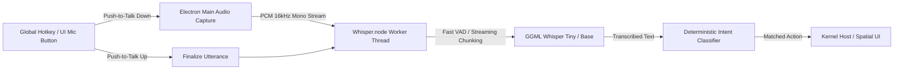
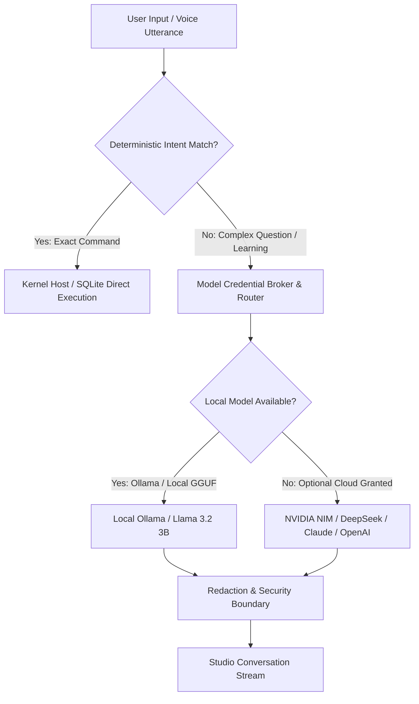
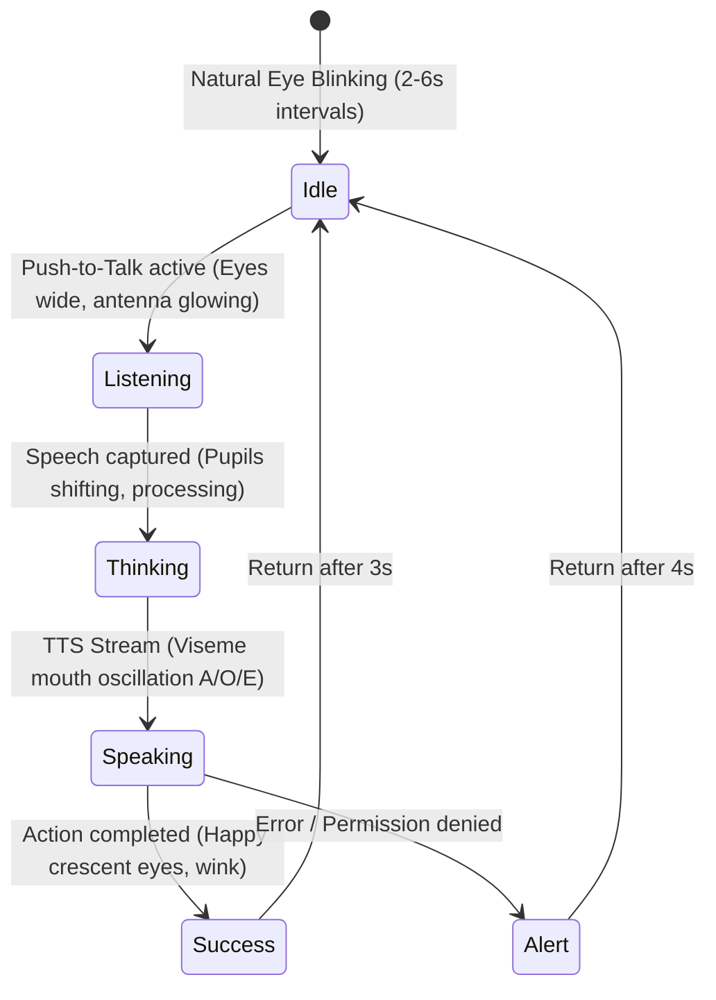
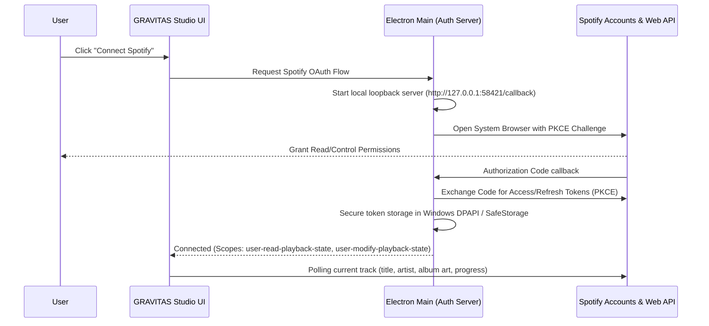

# GRAVITAS 2.0 — Future Integrations Architecture & Integration Plan

## Executive Architecture Summary

GRAVITAS 2.0 transitions the product from a rigid corporate task monitor to a **premium, cozy, playful personal engineering studio with a voice-enabled 2D companion**. 

This document defines the technical integration contract, security boundary, performance envelope, and architectural blueprints for future capabilities beyond the first working vertical slice.

---

## 1. OpenWhispr-Inspired Push-to-Talk & Local Speech Recognition

### 1.1 Architectural Distinction: Native Integration vs Wholesale Cloning
*OpenWhispr* is an open-source macOS/cross-platform floating dictation utility utilizing Whisper.cpp with local audio capture hooks. GRAVITAS does **not** clone OpenWhispr's full desktop application layer; rather, it adopts OpenWhispr's **low-latency streaming pipeline and zero-cloud audio architecture** integrated directly into the Electron main process via a dedicated audio worker thread.

### 1.2 Technology & Dependencies
- **Audio Capture**: Windows CoreAudio via `node-record-lpcm16` or native `naudiodon` (PortAudio binding) streaming 16kHz, 16-bit signed PCM mono audio.
- **Inference Engine**: `@ggerganov/whisper.cpp` Node.js bindings (`whisper-node` or precompiled Windows AVX2 / CUDA binaries).
- **Model Target**:
  - `whisper.cpp tiny.en` (39 MB, ~100ms transcription latency on CPU).
  - `whisper.cpp base.en` (142 MB, ~180ms transcription latency, ideal everyday balance).
- **System Speech Fallback**: Maintain the existing `System.Speech.Recognition` Windows fallback for ultra-low resource devices (verified in `apps/desktop/src/knowledge-hub.test.ts`).

### 1.3 Performance & Permissions
- **Microphone Permissions**: Requested at OS level on first activation; denied state falls back seamlessly to composer text input.
- **Resource Footprint**: The Whisper model is loaded in memory (~180MB RAM) on demand and can be offloaded after 10 minutes of inactivity if on battery power.
- **Threading Model**: Audio recording runs on a dedicated background Worker (`node:worker_threads`), preventing any frame drops or hitching on the 60fps React renderer.

---

## 2. Local & Optional-Cloud Assistant Reasoning Routing

### 2.1 Two-Tier Execution Strategy: Local-First Safety

### 2.2 Security & Determinism Boundary
1. **Zero Fake Commands**: Core studio state mutations (due dates, note updates, app launches) are **strictly handled by deterministic handlers** (`commandParser.ts`). The LLM is never given unbounded shell access or unconfirmed execution power.
2. **Credential Broker**: Cloud APIs are gated behind the existing `ModelCredentialBroker` with per-request token isolation, redacting secrets (`DEFAULT_PATTERNS`, AWS keys, tokens).
3. **Local LLM Option**: Support for local Ollama endpoints (`http://127.0.0.1:11434/v1`) or embedded `node-llama-cpp` for offline study assistance (explaining algorithms, generating study flashcards).

---

## 3. Spoken TTS Responses & 2D Buddy Mouth Lip-Sync

### 3.1 Expression & Viseme Architecture
The 2D companion face is driven by stateful reactive vectors rather than heavy video sprites or full 3D meshes.

### 3.2 TTS Engine Selection
- **Offline Standard (Windows Native)**: SAPI / Windows Media Speech Synthesis (`SpeechSynthesizer`) — 0ms network latency, zero extra dependencies, native Windows voice support.
- **Neural Offline Upgrade**: `piper-tts` (embedded ONNX models, ~50MB, high quality human warmth).
- **Viseme Sync**:
  - TTS audio is processed through a fast Web Audio `AnalyserNode` in the renderer.
  - Energy bands drive SVG mouth height `mouthYScale = clamp(bandPower, 0.2, 1.4)`.
  - Phoneme markers from SAPI `BookmarkReached` / `VisemeReached` drive shape morphs (`neutral`, `open`, `wide`, `round`).

---

## 4. Optional "Hey Grav" Wake Word

### 4.1 Architecture & Safety
Wake-word detection requires persistent audio listening. To protect user privacy and laptop battery life:
- **Default State**: **OFF by default**. Explicit opt-in required in Settings.
- **Engine**: `openWakeWord` or `Porcupine` running entirely on device.
- **Compute Envelope**:
  - `openWakeWord` ONNX runtime: <1.5% CPU utilization on Intel 11th Gen+ / Ryzen 4000+.
  - Audio buffer is a circular in-memory buffer of 1.5 seconds; audio is never written to disk until the wake word triggers.
- **Hardware Indicator**: Electron tray icon and UI buddy antenna glow prominently whenever the microphone is actively listening.

---

## 5. Spotify Authorization, Playback Controls & Mini-Player

### 5.1 Spotify Integration Model

### 5.2 Studio Mini-Player Capabilities
- Compact floating or docked music controller in the Studio Sidebar or top bar.
- Play, Pause, Skip, Previous, Seek.
- Study focus playlists (e.g., Lo-Fi Engineering, Synthwave Code, Classical Focus).
- Deep integration with "Chill Mode" and study timers.

---

## 6. Chill Mode, Entertainment Launchers & Focus Timers

### 6.1 Relaxation & Study Equilibrium
GRAVITAS 2.0 balances deep engineering study with restorative relaxation:
1. **Focus Sessions (Pomodoro & Flow)**:
   - Configurable focus intervals (25m / 50m / 90m flow).
   - Dim non-essential studio elements during flow state.
2. **Chill Mode Trigger**:
   - Single command ("Enter Chill Mode", "Break time", "Open Netflix").
   - Switches studio lighting to warmer cozy amber ambient tones.
   - Launches approved relaxation destination (Netflix, YouTube, Spotify).
   - Companion enters relaxed/sleepy idle animation.
3. **Approved Allowlist Boundaries**:
   - Strictly bounded URLs (`https://www.netflix.com`, `https://open.spotify.com`, `https://www.youtube.com`).
   - Shell metacharacters and arbitrary protocols are rejected fail-closed.

---

## 7. Lazy-Loaded Three.js Living Office

### 7.1 Lifecycle & Resource Isolation
The existing Three.js multi-agent isometric office represents substantial technical value, but running it permanently was battery-destructive and out of place in an everyday creative shell.

| Metric | Previous Permanent 3D | GRAVITAS 2.0 On-Demand 3D |
| :--- | :--- | :--- |
| **Idle GPU Usage** | 18% - 35% continuous | **0.0%** (zero WebGL context active) |
| **Idle Memory (RAM)** | ~450 MB | **~85 MB** |
| **Battery Impact** | Heavy drain | **Negligible** |
| **Mounting Policy** | On window open | **Lazy-loaded on tab click or spatial split** |
| **Teardown Policy** | Never destroyed | **Clean canvas disposal, geometries freed, RAF cancelled** |

### 7.2 Memory Hygiene Guarantee
When the user switches away from the "3D Office" tab or closes the spatial panel:
1. `cancelAnimationFrame(rafId)` is called immediately.
2. WebGL renderer calls `renderer.dispose()`.
3. Scene geometries, textures, and materials are recursively traversed and disposed.
4. Canvas element is unmounted from the DOM.
5. React component transitions back to lightweight 2D vectors.

---

## 8. Implementation Roadmap & Realistic Non-Promises

### 8.1 Roadmap Waves
- **Wave 1 (Delivered in this vertical slice)**:
  - React 19 + TypeScript + Motion modern studio shell.
  - Cozy dark creative studio UI with 1280x800 Windows-first design.
  - Interactive 2D Companion buddy with reactive expressions & thoughts.
  - Spring-animated slide-out spatial workspace panels.
  - Real SQLite tasks ("What's due today?").
  - Real SQLite notes ("Open my Algorithms notes" with in-panel editing & persistence).
  - Real Windows desktop actions ("Open Netflix" allowlisted external action).
  - On-demand Three.js Living Office viewport.
- **Wave 2**:
  - Embedded Windows Audio Core push-to-talk with local Whisper base.en worker.
  - Viseme lip-sync animation for 2D companion face using Web Audio frequency bands.
  - Spotify PKCE OAuth flow and compact docked mini-player.
- **Wave 3**:
  - Study Focus & Chill Mode state machine with timed breaks and companion coaching.
  - Local Ollama / GGUF model connector for offline algorithm explanation.
  - Optional opt-in wake word detection ("Hey Grav").

### 8.2 What Cannot Be Promised (Engineering Honesty)
1. **Unbounded Autonomous OS Control**: We will not provide unrestricted shell execution to LLMs; all system commands must remain bounded and allowlisted for user safety.
2. **Real-time 3D Facial Lip-Sync on Battery**: A heavy 3D character with blend shapes will not run continuously on typical laptop hardware without draining battery; the lightweight 2D vector companion is the approved everyday companion.
3. **Cloud-Dependent Mandatory Features**: The core studio, notes, tasks, companion, and local audio must remain 100% functional without an internet connection.
