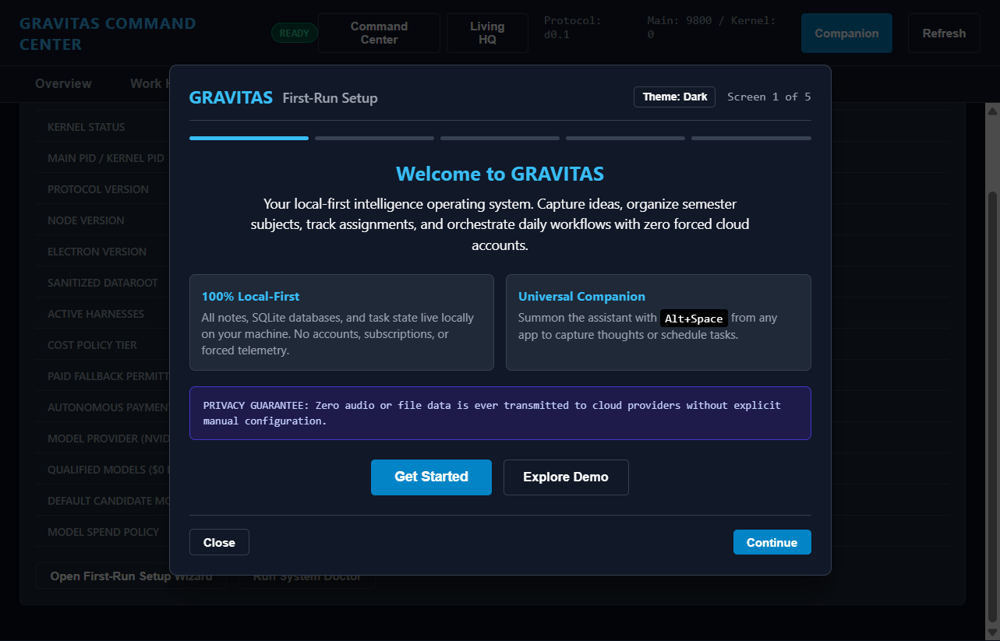
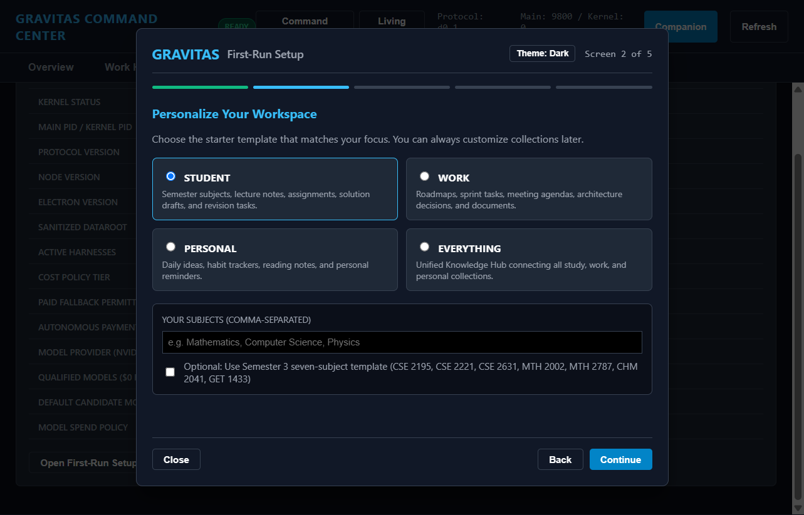
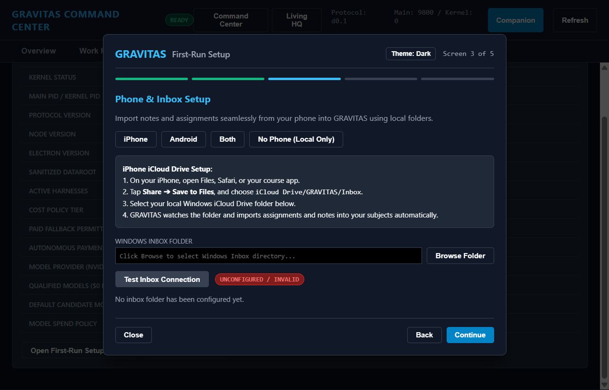
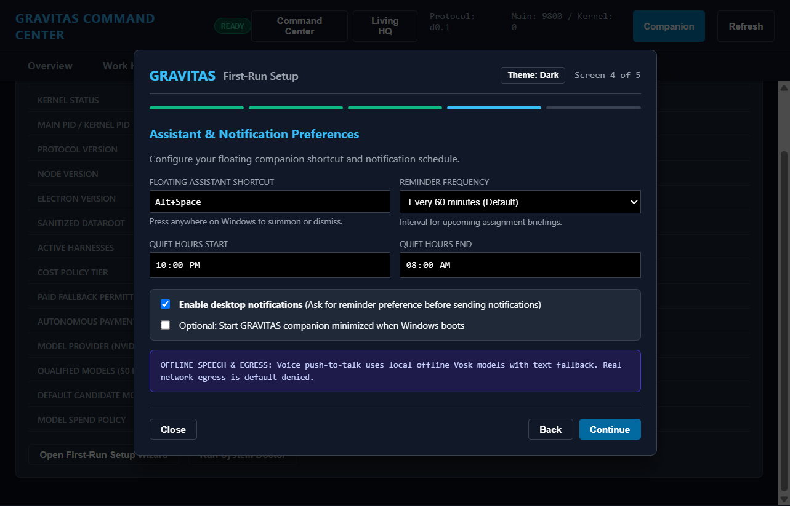
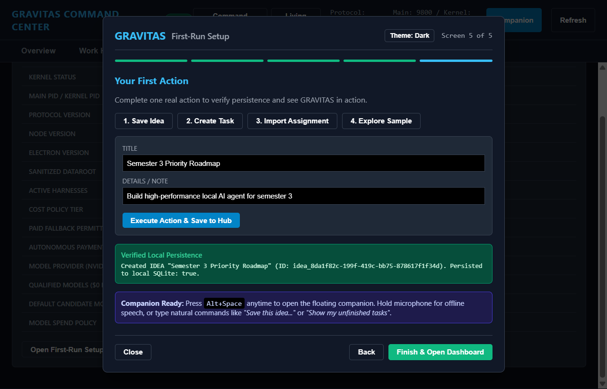
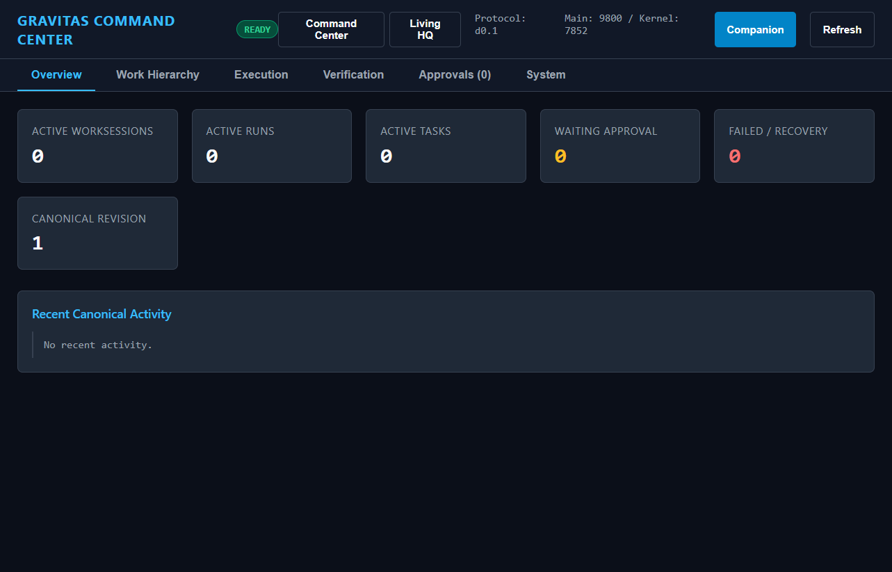

# GRAVITAS Wave V1-G-02 — Verification & Delivery Evidence
## Premium First-Run Onboarding + Universal Phone Setup

- **Repository**: `C:\Users\smara\Desktop\Multi-agent`
- **Branch**: `feat/v0-golden-loop`
- **Base HEAD**: `cf47a54efaf202138834112e490a0a742d70855b`
- **Date**: 2026-10-13

---

## 1. Overview & Verification Summary

Wave **V1-G-02** implements a consumer-grade, 5-screen first-run onboarding wizard for GRAVITAS desktop, replacing the technical 8-step internal developer diagnostic dialog with an onboarding journey inspired by the best UX patterns of Notion, Todoist, Linear, Raycast, and Slack.

All architectural invariants and constraints have been preserved:
- **100% Local-First**: No mandatory cloud accounts, subscriptions, or telemetry.
- **Privacy Guaranteed**: Zero microphone audio or note content is egressed to cloud providers; default-deny real network egress is enforced.
- **Arbitrary Persona Support**: The user is never forced into developer subjects. Student persona supports arbitrary subject lists, with an optional toggle for the Semester 3 seven-subject template. Work, Personal, and Everything personas populate appropriate collections.
- **Universal Phone Setup**: First-class support for iPhone (iCloud Drive / Share Sheet), Android (Syncthing / LocalSend folder sync with explicit, honest disclosure — no claimed native Android app), Both, and Local-only.
- **Action-Driven First Success**: Guided first step executes against the real local SQLite Knowledge Hub and displays verified item persistence before revealing the dashboard.
- **Offline Speech & Assistant**: Floating assistant shortcut (default `Alt+Space`) is highlighted alongside quiet hours and notification consent.

---

## 2. Research-Informed Design Principles

| Design Pattern | Inspiration | Implementation in GRAVITAS |
| :--- | :--- | :--- |
| **Personalize Starter Content** | **Notion** | Screen 2 provides 4 distinct persona archetypes (`STUDENT`, `WORK`, `PERSONAL`, `EVERYTHING`). Non-student personas clear unneeded academic defaults. |
| **Guide to Real Completed Action** | **Todoist** | Screen 5 asks user to execute one real action (Save Idea, Create Task, Import Assignment, or Explore Sample) directly into SQLite. |
| **Explorable Demo** | **Linear** | Screen 1 "Explore Demo" pre-populates sample Knowledge Hub records and allows immediate walkthrough without manual setup. |
| **Teach Shortcut by Use** | **Raycast** | Prominently teaches `Alt+Space` floating assistant summon shortcut, with customizable keybinding in Screen 4. |
| **Notification Permission Timing** | **Slack** | Explicitly asks for reminder frequency and quiet hours before scheduling desktop notifications. |
| **No Dark Patterns** | **Core Invariant** | Every optional step is skippable, no forced credit card, no forced account, no fake sync claims. |

---

## 3. 5-Screen Walkthrough & Captured Screenshots

Real Electron application screenshots captured via Playwright automation:

### Screen 1: Welcome (`docs/v1-g-02/screenshots/01-welcome.png`)

- GRAVITAS branding and local-first value proposition.
- Clear privacy guarantee: zero audio or file data leaves the machine.
- Dual primary actions: **Get Started** and **Explore Demo**.
- Light/Dark theme toggle support.

---

### Screen 2: Personalize Workspace (`docs/v1-g-02/screenshots/02-personalize.png`)

- Select from 4 archetypes: `STUDENT`, `WORK`, `PERSONAL`, `EVERYTHING`.
- Student mode allows arbitrary comma-separated subjects (e.g., Mathematics, Computer Science, Physics).
- Optional toggle: "Use Semester 3 seven-subject template".
- Non-student selections clear unneeded default academic subjects safely.

---

### Screen 3: Phone & Inbox Setup (`docs/v1-g-02/screenshots/03-phone-setup.png`)

- Platform tabs: **iPhone**, **Android**, **Both**, **No Phone (Local Only)**.
- Step-by-step guidance for iPhone Share Sheet / iCloud Drive Save to Files workflow.
- Honest Android guidance: Syncthing / LocalSend pairing to a local folder. Explicitly disclaims any proprietary Android app.
- Interactive **Test Inbox Connection** validating folder accessibility, awaiting file status, local import history, and cross-device sync evidence.

---

### Screen 4: Assistant & Notification Preferences (`docs/v1-g-02/screenshots/04-assistant-prefs.png`)

- Floating assistant global shortcut (default `Alt+Space`).
- Reminder frequency selection (30m, 60m, 2h, 4h).
- Quiet hours window (e.g., 22:00 to 08:00) respecting student sleep schedules.
- Desktop notification permission checkbox and optional Start with Windows toggle.
- Clear notice regarding offline speech recognition (Vosk) and default-denied cloud egress.

---

### Screen 5: First Success Action (`docs/v1-g-02/screenshots/05-first-success.png`)

- Action choices: Save Idea, Create Task, Import Assignment, Explore Sample.
- Form executes real action against `IdeasVaultStore` / `StudyGuardianService`.
- Displays real verified persistence confirmation banner with item UUID and storage backend (`sqlite_ideas_vault`).
- Quick guide on summoning the companion and natural voice/text commands.

---

### Dashboard Revealed (`docs/v1-g-02/screenshots/06-dashboard-revealed.png`)

- Onboarding modal dismisses cleanly, revealing the active Command Center dashboard with seeded collections and verified persistence.

---

## 4. Universal Phone & Inbox Verification States

The inbox verification engine (`OnboardingService.verifyInbox`) evaluates the configured directory and returns deterministic states:

| State | Condition | UI Badge |
| :--- | :--- | :--- |
| `UNCONFIGURED` | Directory does not exist, path is null/empty, or access is denied. | `UNCONFIGURED / INVALID` |
| `FOLDER_ACCESSIBLE` | Directory exists and is read/write accessible, but currently contains 0 files and 0 historical imports. | `FOLDER ACCESSIBLE` |
| `AWAITING_FIRST_FILE` | Directory contains pending files awaiting assignment ingestion, but no files have been imported yet. | `AWAITING FIRST FILE` |
| `LOCAL_IMPORT_VERIFIED` | At least one assignment or file has been successfully imported through the inbox pipeline. | `LOCAL IMPORT VERIFIED` |
| `CROSS_DEVICE_SYNC_VERIFIED` | Cross-device evidence detected: presence of `.icloud` sync markers, mobile camera/recording filenames (`IMG_`, `RPReplay_`, `Scan_`, `PXL_`), or Syncthing markers (`.stfolder`, `.stversions`). | `CROSS-DEVICE SYNC VERIFIED` |

---

## 5. Automated Test Verification

The onboarding test suite spans 54 unit and diagnostic tests across `apps/desktop`:

```text
✓ apps/desktop/src/study-guardian.test.ts (6 tests) 644ms
✓ apps/desktop/src/onboarding-wizard.test.ts (25 tests) 1362ms
✓ apps/desktop/src/onboarding.test.ts (23 tests) 2532ms

Test Files  3 passed (3)
     Tests  54 passed (54)
```

### Coverage in `apps/desktop/src/onboarding-wizard.test.ts` (25 Tests):
1. **Fresh Launch & State Machine**:
   - Fresh launch initializes with `WELCOME` step and uncompleted status.
   - Idempotent configuration writes and step advancement.
2. **Persona Setup & Subject Seeding**:
   - `STUDENT` with custom subjects creates exactly the specified subjects without Semester 3 defaults.
   - `STUDENT` with 7-subject template flag seeds all 7 curriculum subjects with subfolders.
   - Non-student personas (`WORK`, `PERSONAL`) clear unneeded default academic subjects cleanly without error when tables are empty or populated.
   - `EVERYTHING` persona retains all subjects and initializes unified hub collections.
3. **Phone & Inbox Verification Pipeline**:
   - Returns `UNCONFIGURED` for nonexistent directory.
   - Returns `FOLDER_ACCESSIBLE` for empty accessible folder.
   - Returns `AWAITING_FIRST_FILE` when files exist in inbox before import.
   - Returns `LOCAL_IMPORT_VERIFIED` when inbox records exist in database.
   - Returns `CROSS_DEVICE_SYNC_VERIFIED` when iCloud metadata `.icloud` is detected.
   - Returns `CROSS_DEVICE_SYNC_VERIFIED` when mobile image filenames (`IMG_4021.pdf`) are present.
   - Returns `CROSS_DEVICE_SYNC_VERIFIED` when Syncthing marker (`.stfolder`) is detected.
4. **Preferences & Schedule Configuration**:
   - Persists floating assistant shortcut, reminder interval, and quiet hours.
   - Gating logic blocks notifications during quiet hours (e.g. 23:30 within 22:00–08:00).
   - Allows notifications outside quiet hours.
   - Default-denied network egress preference recorded.
5. **First-Success Action & Persistence**:
   - Executing `FIRST_IDEA` creates real persistent record in `IdeasVaultStore`.
   - Executing `FIRST_TASK` creates real task in `IdeasVaultStore`.
   - Executing `EXPLORE_SAMPLE` populates sample workspace and verifies persistence.
   - Onboarding completion records `completed: true`, timestamp, and closes modal.
6. **KernelHost IPC Plumbing**:
   - `APPLY_PERSONA_SETUP` IPC dispatch executes without throwing.
   - `TEST_INBOX_SETUP` IPC dispatch returns verification result.
   - `EXECUTE_FIRST_SUCCESS` IPC dispatch returns item ID and verification message.
   - `RESET_ONBOARDING` IPC restores initial onboarding step for rerun capability.

### Full Monorepo Typecheck:
```text
> gravitas@0.0.1 typecheck
> npm run typecheck --workspaces --if-present

@gravitas/agents: clean
@gravitas/browser-qa: clean
@gravitas/core: clean
@gravitas/gateways: clean
@gravitas/git: clean
@gravitas/harnesses: clean
@gravitas/orchestrator: clean
@gravitas/prompts: clean
@gravitas/verifier: clean
@gravitas/desktop: clean
@gravitas/server: clean
@gravitas/web: clean
```

---

## 6. Commit Log

The changes are partitioned into 3 clean, local commits:

1. **Commit 1 (`dc61255c03f92e35f163b3bb8133cb409d242020`)**: `feat(onboarding): add personalized first-run wizard`
   - Config types (`PersonaArchetype`, `OnboardingPreferences`, `OnboardingStep`).
   - `OnboardingService` supporting persona seeding, subject templates, and arbitrary subject lists.
   - Integration with `ICloudAssignmentInbox` for non-destructive subject creation and clearing.
   - KernelHost IPC handlers and full test suite (`onboarding-wizard.test.ts`).

2. **Commit 2 (`54e685c9768c83eb2fdf28beba544b51772df8c3`)**: `feat(onboarding): add universal phone and inbox setup`
   - Universal phone setup platform models (`IPHONE`, `ANDROID`, `BOTH`, `NONE`).
   - Deterministic 5-state inbox verification engine with cross-device evidence heuristics.
   - Honest Android Syncthing/LocalSend pairing instructions and folder picker integration.

3. **Commit 3 (HEAD)**: `feat(onboarding): add first-success tutorial and polish`
   - 5-screen first-run wizard UI in `index.html` and `renderer.ts`.
   - Action-driven first success execution (Idea, Task, Assignment, Sample) with verified persistence card.
   - Companion shortcut, reminder frequency, and quiet hours configuration.
   - Complete screenshot artifacts and verification evidence in `docs/v1-g-02/EVIDENCE.md`.
